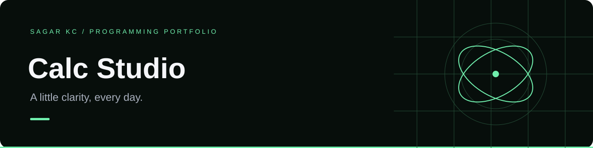

# Calc Studio

A focused browser calculator with keyboard input, expression parsing, and saved calculation history.

**HTML · CSS · JavaScript · Node.js tests**

## Features

- Addition, subtraction, multiplication, and division with standard precedence
- Parentheses, negative numbers, decimal values, and postfix percentages
- Clickable keypad, keyboard input, backspace, and Escape to clear
- Last 20 calculations stored locally, with reuse and clear-history controls
- Clear error messages for incomplete input and division by zero
- Responsive layout and labelled controls

## Run

Open `index.html` in your browser. For a local server:

```sh
python -m http.server 8000
```

Visit http://localhost:8000. On Windows, use `py` instead of `python` if necessary.

## Test

With Node.js installed, run `npm test` or `node test.cjs`. No npm dependencies are required.

## Example expressions

| Input | Result |
| --- | --- |
| `2 + 3 * 4` | 14 |
| `(2 + 3) * 4` | 20 |
| `200 * 15%` | 30 |
| `0.1 + 0.2` | 0.3 |

Percentage is a postfix divide-by-100 operation, so `100 + 10%` means `100 + 0.1`. Results are rounded to 12 significant digits for display; this is an everyday calculator rather than an arbitrary-precision financial tool.

## Architecture

`engine.js` tokenizes the expression and evaluates it with a recursive-descent parser. It does not use `eval` or execute input as JavaScript. `app.js` handles input, display, history, and storage. `style.css` defines the responsive interface.

## Next improvements

- Scientific notation input and memory keys
- Theme preference
- End-to-end browser automation
